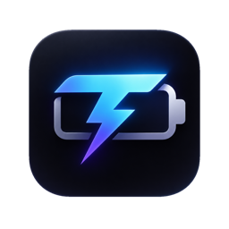

<div align="center">
    
    <h1>Thorion — Battery Monitor & Charge Limiter for macOS</h1>
    <p><strong>A smarter battery icon for your MacBook.</strong> Monitor power metrics, manage charge limits, and extend your battery's lifespan — all from the menu bar.</p>
</div>

<div align="center">

[](https://github.com/cavaldos/Thorion/releases/latest)
[](https://github.com/cavaldos/Thorion/releases)


[](https://github.com/cavaldos/Thorion/stargazers)
[](LICENSE)
[](https://ko-fi.com/calvados)

<br>

<a href="https://ko-fi.com/calvados" target="_blank">
    
</a>

</div>

Thorion gives you real-time insight into your MacBook's power system and lets you control charging behavior directly, without relying on macOS's opaque "Optimized Battery Charging."

> [!IMPORTANT]
> **Apple Silicon only.** The way metrics and charging are controlled differs a lot between Intel and Apple Silicon, so only Apple Silicon MacBooks are supported. Requires **macOS 14.8+**.


## Install

**Homebrew** (recommended — updates with `brew upgrade`):

```bash
brew tap cavaldos/tap
brew install --cask cavaldos/tap/thorion
```

**Manual:**

1. Download `Thorion.dmg` from the [latest release](https://github.com/cavaldos/Thorion/releases/latest).
2. Open the DMG and drag Thorion into `/Applications`.
3. Clear the quarantine flag — releases are ad-hoc signed and not notarized, so Gatekeeper would otherwise block the first launch:

```bash
xattr -dr com.apple.quarantine /Applications/thorion.app
```

Then open Thorion from Applications. Thorion checks GitHub for new versions once a day and sends a notification when one is available (you can turn this off in **Settings → General**).

Want to build from source or contribute? See [script/README.md](script/README.md).

## Uninstall

**Homebrew:**

```bash
brew uninstall --cask cavaldos/tap/thorion
```

**Manual:** quit Thorion, then drag it out of `/Applications` to the Trash. To also remove preferences, delete `~/Library/Preferences/com.thorion.app.plist`.

## Highlights

- **Charge Limit** — Set a max charge level (50–100%) enforced at the hardware level, even through sleep.
- **Sailing Mode** — Avoid micro-charging by letting the battery float within a configurable range.
- **Automatic Discharge** — Drain to your target level while staying plugged in.
- **Heat Protection** — Pause charging when battery temperature gets too high.
- **Power Dashboard** — Live voltage, current, wattage, temperature, health, and cycle count in the menu bar.
- **Power Flow Diagram** — Sankey visualization of real-time power distribution.
- **MagSafe LED Control** — Green at limit, orange while charging.

For detailed feature explanations, settings walkthroughs, architecture info, and FAQ, see the upstream **[Stasis Wiki](https://github.com/srimanachanta/Stasis/wiki)** — most of it still applies to Thorion.

## Contributing

Contributions are welcome! Read the [development guide](script/README.md) to build the app locally, and please open an issue first for large changes.

## Support

If Thorion helps your battery live longer, consider buying me a coffee:

<a href="https://ko-fi.com/calvados" target="_blank">
    
</a>

<a href="https://www.paypal.com/paypalme/nnkhanh29" target="_blank">
    
</a>

## Acknowledgments

Thorion is a fork of [Stasis](https://github.com/srimanachanta/Stasis) by [Sriman Achanta](https://github.com/srimanachanta) — huge thanks for the original work this project builds on.

Also built on the shoulders of:

- [SMCKit](https://github.com/srimanachanta/SMCKit) — SMC access library
- [AsahiLinux](https://asahilinux.org/) — SMC key reverse engineering
- [Battery-Toolkit](https://github.com/mhaeuser/Battery-Toolkit) — SMC key documentation

## License

[GPL-3.0](LICENSE) — Thorion is and will always remain open-source and free.

## Star History

<a href="https://star-history.com/#cavaldos/Thorion&Date">
    
</a>
